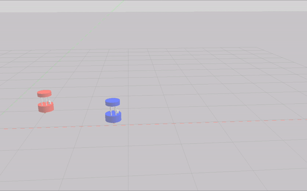
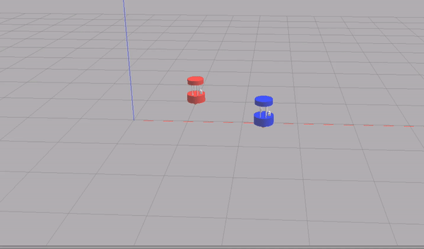

# Checkpoint 8 - TF for ROS 2

"Catch Me If You Can" — a C++ ROS 2 node that uses **TF2 transforms** to make one robot (Rick) chase another robot (Morty) in real time. Rick reads the transform between his own base frame and Morty's, computes distance and angle errors, and applies proportional control to pursue Morty through the environment.

Continuation of [Checkpoint 7](https://github.com/mathrosas) (Barista Robot URDF/Xacro). Part of the [ROS & ROS 2 Developer Master Class](https://www.theconstructsim.com/) certification (Phase 1).

<p align="center">
  
</p>

## How It Works

<p align="center">
  
</p>

### Algorithm

1. Looks up the TF transform from `rick/base_link` to `morty/base_link` at every tick (10 Hz)
2. Extracts the translation vector (dx, dy) between the two frames
3. Computes:
   - `error_distance` = euclidean distance between the two frames
   - `error_yaw` = angle to Morty using `atan2(dy, dx)`
4. Applies proportional control:
   - `linear.x` = `kp_distance` (0.8) * `error_distance`
   - `angular.z` = `kp_yaw` (2.0) * `error_yaw`
5. Stops when within 5 cm of Morty (`error_distance < 0.05`)

### Expected Behaviors

| Scenario | Rick's behavior |
|---|---|
| Morty drives straight | Rick accelerates to catch up, follows behind |
| Morty drives in circles | Rick matches speed, follows the circular path |
| Morty stops | Rick slows down, makes a small bump, comes to a full stop |

## Tasks Breakdown

This checkpoint spans two repos:

### Task 1 - Multi-Robot Simulation (`barista_robot_description`, tag: `multiple-robots`)

- Created `barista_two_robots.launch.py` spawning Rick (blue) and Morty (red) in Gazebo
- Each robot has its own namespace (`/rick/`, `/morty/`), topics, and TF tree
- Static TF publishers bridge `world` frame to each robot's odom frame
- Both robots controllable independently via teleop

### Task 2 - Robot Chase (`robot_chase`, tag: `robot-chase`)

- Created `robot_chase` C++ package with TF2 listener
- Proportional controller using `lookupTransform` between `rick/base_link` and `morty/base_link`
- Publishes velocity commands to `/rick/cmd_vel`

## ROS 2 Interface

| Name | Type | Description |
|---|---|---|
| `/rick/cmd_vel` | `geometry_msgs/Twist` (publisher) | Velocity commands to Rick |
| `rick/base_link` → `morty/base_link` | TF2 transform (listener) | Relative position between robots |

## Project Structure

```
robot_chase/
├── CMakeLists.txt
├── package.xml
├── include/
├── src/
│   └── robot_chase.cpp       # TF2 chase node
└── media/
```

## How to Use

### Prerequisites

- ROS 2 Humble
- Gazebo Classic 11
- [Checkpoint 7](https://github.com/mathrosas) `barista_robot_description` package compiled

### Build

```bash
cd ~/ros2_ws
colcon build --packages-select robot_chase barista_robot_description
source install/setup.bash
```

### Launch

```bash
# Terminal 1 - Spawn Rick and Morty
ros2 launch barista_robot_description barista_two_robots.launch.py

# Terminal 2 - Start the chase
ros2 run robot_chase robot_chase

# Terminal 3 - Drive Morty with teleop
ros2 run teleop_twist_keyboard teleop_twist_keyboard --ros-args --remap cmd_vel:=/morty/cmd_vel
```

Rick will immediately start chasing Morty. Use the teleop keyboard to drive Morty and watch Rick follow.

## Git Tags

| Tag | Repo | Description |
|---|---|---|
| `multiple-robots` | `barista_robot_description` | Multi-robot launch with namespaces and independent TF trees |
| `robot-chase` | `robot_chase` | Proportional TF2-based chase controller |

## Key Concepts Covered

- **TF2 transforms**: `lookupTransform` between namespaced robot frames
- **Proportional control**: distance and yaw error-based velocity commands
- **Multi-robot simulation**: namespaced topics, TF frames, independent control
- **TF2 Buffer/Listener**: real-time frame relationship queries in C++
- **ament_cmake**: building C++ ROS 2 nodes with TF2 dependencies

## Technologies

- ROS 2 Humble
- C++ 17
- TF2 (`tf2_ros`, `tf2_geometry_msgs`)
- Gazebo Classic 11
